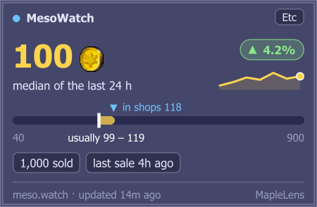
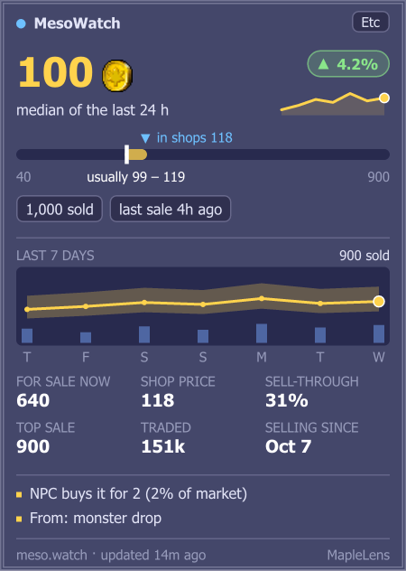
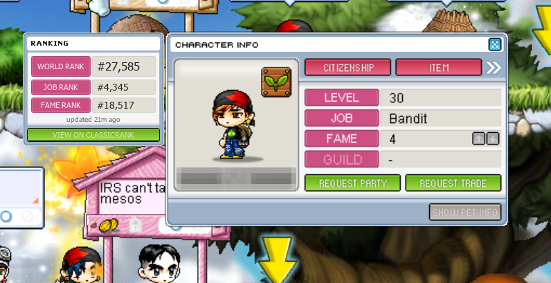
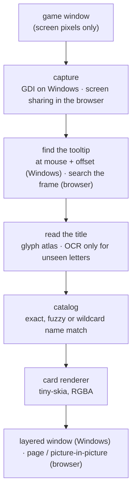

<div align="center">


# MapleLens

**In-game overlays for MapleStory Classic.**
Hover an item, see what it is worth. No injection, no memory reading, no game files touched.


**[Download for Windows](https://github.com/MapleLens/maplelens/releases/latest)** ·
**[Open in your browser](https://maplelens.github.io/maplelens/app/)** ·
[Website](https://maplelens.github.io/maplelens/)

</div>

## ✨ Features

| | |
|---|---|
| 🪙 **Live price card** | Hover any inventory item and a card appears beside its tooltip with the [MesoWatch](https://meso.watch) price. |
| 🗺️ **Map helper** | Hover a location on the **world map** and a card appears beside its tooltip with the monsters that spawn there (level, EXP, HP, spawn points and share) and the NPCs you can meet, each with their sprite. Data and sprites come from [maplestory.io](https://maplestory.io) (classic‑era data, so spawn counts are close to, not exactly, the live game). Every monster and NPC is listed; big towns flow into extra columns to fit the game window. Maps and sprites are downloaded once and kept in `%LOCALAPPDATA%\MapleLens\cache`, so repeat hovers are instant. |
| 🏪 **Store Permit watcher** | While your own shop is open, MapleLens reads its Sold Items list, chat log and meso counter: every sale (item, buyer, quantity), visitors coming and going, chat, and the store closing. It finds the shop window at any resolution, Ideal or Default Ratio, windowed or full screen, and keeps following it when you switch. Its text is read with the game's own shop fonts, so OCR is only asked about letters they can't read. A small pill at the game's bottom-left says whether it can see everything it needs. It keeps watching while the game is behind other windows. Never counts a sale twice: identical sales are each counted once, and anything it cannot line up is reported, not guessed. Sold items and the store opening or closing can be posted to a Discord channel (paste its webhook URL in the settings) and to Telegram (make a bot with @BotFather, paste its token, send the bot /start, then press Test); the browser version does the same. |
| 🏆 **Player rank panel** | Open a player's **Character Info** window and a panel in the game's own style (pink labels, beige boxes) appears beside it with their world, job and fame rank from the public [classicrank.com API](https://classicrank.com/developer) (no key; cached, rate‑limit friendly). Hides if there is no room inside the game. |
| 🔤 **Reads the game's own letters** | Titles are read by matching the game font's glyphs, so names come out exactly and the same every frame. Letters it has not seen yet fall back to OCR once and are learnt for next time. |
| 🌐 **Two ways to run it** | A 5 MB Windows app that draws the card right beside the tooltip, or the same engine compiled to WebAssembly in your browser, with nothing to install. |
| 🧭 **Smart placement** | Right of the tooltip; left near the screen edge; below for equipment compare (two tooltips). |
| 🎨 **Truly translucent** | Per‑pixel alpha like the game's own box (see‑through fill, solid text), Tahoma font, same borders and bullet, drawn sharp at the game's size. |
| 👀 **Glance first, details on dwell** | Hover and you get the answer at once: price, trend, week sparkline, where the price sits in its range, how it sells. Keep the pointer on the item for ~1 s and the card grows into the full view. |
| 📈 **Everything MesoWatch knows** | Typical price + basis, trend, price‑range bar, 7‑day median/low‑high chart with volume bars, sales, sell‑through, listings, shops, traded volume, first sale. |
| 💡 **Insights** | Fast/slow seller, low‑data warning (`~` before the price), scrolled sales, NPC floor price, crafting profit, NX price, drop sources. |
| 🔢 **Readable numbers** | `1320 → 1.32k`, `10500 → 10.5k`, `2300000 → 2.3m`. |
| ⚡ **Keeps up with your mouse** | Captures only around the cursor and caches every read, so the card follows at the speed you move. |
| 🧊 **Rock steady** | Placed from the mouse position, not from per‑frame detection, so nothing jitters. |
| 🪟 **Game only** | Shown only while MapleStory is the front window, and always inside it. |
| 👻 **Click‑through** | The overlay never steals mouse input or focus from the game. |
| 🛡️ **Screen‑only** | Reads pixels from the screen. Nothing is injected into, read from or sent to the game process. |

## 🖼️ Showcase

Real screenshots of MapleLens running in the game. Other players' name plates are pixelated; the price numbers are one
item's figures from MesoWatch (used with permission), credited on the card.

### 🪙 Item price overlay


Point at an item in your inventory (here **Opal Ore**) and the card appears beside the game's own tooltip.

- **Price** in gold with the meso coin, a **trend pill** (green up / red down) and a **week sparkline**.
- **Range bar:** the dark groove is the lowest to highest sale seen, the gold band is where most sales happen (labelled underneath), the white tick is the typical price. The blue **in shops N** arrow is the median price shops list it for right now, on the same scale; it turns amber when shops ask 20%+ more than it actually sells for.
- **Signal pills:** how fast it sells, how many sales, how recent the last one is.
- **Full card** (after about a second on the item) adds the 7-day chart with volume bars, market depth (sell-through, items for sale, shops, traded volume) and where the item comes from.
- It sits **right of the tooltip**, **left** near the screen edge, and **below** when an equipment compare tooltip is open.

**Two sizes of the same card** (demo numbers):

| Glance: what you see when you hover | Full: after keeping the pointer on the item |
|---|---|
|  |  |

### 🛒 In shops and on Cash Shop items


It works the same inside a player's shop window: here a **Selective 5-slot Coupon** listed at 54,999 mesos next to a
card showing the market median (44k), a "Fast seller" pill and the NX price (5,000 NX).

### 🏆 Player rank panel



Open a player's **Character Info** window and the ranking panel appears beside it, in the game's own window style.

## 🚀 Getting started

### Windows app (recommended)

1. Download `maplelens-vX.Y.Z-windows.zip` from the [latest release](https://github.com/MapleLens/maplelens/releases/latest) and unzip it anywhere.
2. Start MapleStory Classic, then double‑click **`maplelens.exe`**. A meso coin appears in the tray (bottom right).
3. Click the game, open your inventory or a shop and **hover an item**. 🎉

> Windows may show a blue "Windows protected your PC" box for a new download. Click **More info → Run anyway**.
> The source is all here; the release is built by GitHub Actions from this repository.

MapleLens downloads the price data it needs and refreshes it hourly while running; a failed update keeps the last
good copy, and without any copy it shows two built-in demo items. Right‑click the tray icon for **Show overlays**,
**Settings** (start with Windows, the show/hide hotkey, Ctrl+Alt+M by default, and how soon the card expands) and **Exit**.

**Updates.** Once a day MapleLens asks GitHub whether a newer release exists (turn this off in Settings). The tray
says when one is waiting; **Update now** downloads it, checks its signature and checksum, makes sure the new exe
starts, swaps it in and restarts. Nothing is installed without your click, and an unsigned or altered download is
refused.

| Flag | What it does |
|---|---|
| `--snapshot PATH` | Use a local `list.json` without automatic updates |
| `--debug` | Also log detection details to `maplelens.log`, save each new tooltip capture to `debug\` (future test fixtures, including `map_scan.png`) and print Store Permit events (kept in `debug\shop_events.log`) |
| `--shop` | Only watch your Store Permit and print its events (sales, visitors, chat, closing) to the console |
| `--screenshot OUT.png [--wait S] [--blur X,Y,W,H]` | Save a picture of the game with MapleLens's cards drawn in, for docs and bug reports |
| `--version` | Print the version |

MapleLens always writes warnings and errors to `maplelens.log` next to `maplelens.exe`. If something breaks, send
that file along with your report. Settings, cached prices and learnt letters live in `%LOCALAPPDATA%\MapleLens`.

### In your browser

Open **[MapleLens Web](https://maplelens.github.io/maplelens/app/)** in Chrome or Edge, click **Share game window**
and pick MapleStory. Hover items as usual; the cards show in the page, or click **Pop out over the game** for a small
window that floats on top. Everything runs in your browser tab: no frame is uploaded.

Differences from the Windows app: the browser cannot draw over another program or know where your mouse is, so the
card shows in that floating window instead of beside the tooltip, and the tooltip is found by searching the frame.
Prices come from MesoWatch (with their permission: fetched at most once every 30 minutes and kept in your browser), ranks from classicrank.com.

### If something goes wrong

| Problem | What to do |
|---|---|
| Nothing appears when I hover | The game must be the **front window** (click on it). Run both the game and MapleLens the normal way (not one "as administrator" and the other not). |
| The card says "No price data" | That item has no sales on MesoWatch yet, or the name was misread. Hover again; send `maplelens.log` if it keeps happening. |
| Only Emerald Ore and Tree Branch show prices | That is demo mode: the price list could not be loaded (no internet?). The web version asks MesoWatch at most every 30 minutes, so give it that long. |
| A new item's name reads with `?` | MapleLens has not seen one of its letters yet. With an OCR language installed (Windows: **Settings → Time & language → Language & region**, English), it reads it once and learns it. |
| The card is in the wrong place | Only the default UI layout is calibrated. Tooltips flipped to the other side of the mouse (near the right/bottom screen edge) are not supported yet. |
| Browser: no card | Choose the game's own window in the share dialog, and try **Settings → Game window** (full screen vs windowed). |

## ⚠️ Can I get banned?

**Short answer: very unlikely, but nobody outside Nexon can promise it.** MapleLens is not made, approved or
endorsed by Nexon, and Nexon has not published a rule that says overlays like this are allowed or banned.

**What MapleLens does, technically.** It works like a screen recorder with a see‑through window on top, and every
Windows call it makes is one that Discord's "share a window", OBS or a screenshot tool also makes:

| Anti-cheat looks for… | MapleLens |
|---|---|
| Reading or writing game memory | ❌ Never. It copies screen pixels (`BitBlt` of the desktop), like a screenshot. The Store Permit watcher reads the game window's picture through Windows Graphics Capture, the API OBS and Discord use for window capture, so it works while the game is covered. |
| Opening the game's process | ❌ Never. It finds the game in the system's process list (a snapshot that carries program names) and its window through the window manager. |
| Injecting code, DLLs or hooks into the game | ❌ Never. No hooks of any kind, not even a keyboard hook: the show/hide shortcut is a registered hotkey. |
| Pressing keys or clicking for you | ❌ Never. It sends no input at all; it only reads where your mouse already is. |
| Changing game files or network traffic | ❌ Never. Its only downloads are MesoWatch prices, classicrank.com ranks, maplestory.io map data and sprites, and its own signed updates from GitHub. |
| Playing the game for you | ❌ Never. It shows information; you do everything yourself. |

The browser version is the browser's own window sharing: it cannot touch the game process at all.

**What Nexon's rules say.** Nexon's
[User Abuse policy](https://support-maplestory.nexon.com/hc/en-us/articles/204737315-What-activities-constitute-User-Abuse)
bans botting and using "a third-party program … to play the game in a manner that is not intended by the creators",
and Nexon's notices say unauthorised third‑party software is against the Terms of Service. They keep no public list
of allowed or banned programs. Bans reported around MapleStory anti-cheat updates have involved bots, macros and
remote-play tools that send input; MapleLens sends none, but the wording is broad and Nexon decides.

## 🧠 How it works



1. **Capture** a small patch at the mouse position plus a fixed offset: the game always draws the item tooltip there. Nothing is captured or drawn while the game is not the foreground window. (The browser has no mouse position, so it searches the frame for the tooltip's fill band and borders.)
2. **Check** a tooltip is there (a recognised title is the proof; the blue fill is only a fallback). Equipment also reads a second title further right to spot compare mode.
3. **Read** the title by cutting it into letters and matching them against an atlas of the game font's glyphs. Unknown letters read as `?`; the catalog still finds the item when the rest of the name is clear, and Windows OCR (Tesseract in the browser) fills in the rest. A read the catalog confirms teaches the atlas the new letters.
4. **Match** the text against the MesoWatch catalog (exact key first, then fuzzy, then with `?` as a wildcard).
5. **Render** the card once per item, then **place** it from the live mouse position every tick (so it moves with the mouse, not with detection latency).

## 🗂️ Project layout

```
crates/
├── core/    everything platform-free: vision (tooltip, glyph reader, window search), market data, catalog,
│            rank cache, card rendering, placement, the detection state machines. Unit tests on real captures.
├── win/     the Windows app: GDI capture, layered overlay window, tray, settings window, Windows OCR, updates
└── web/     the WebAssembly engine behind the browser version
docs/        the website (GitHub Pages) and the web app (docs/app), including the compiled engine (docs/app/pkg)
tests/       real game captures (fixtures) and the old Python version's answers on them (golden)
scripts/     bump-version.ps1, build-web.ps1
```

See [AGENTS.md](AGENTS.md) for architecture rules and how to extend it.

## 📜 Data, terms and licences

**This project.** MapleLens is open source under the [MIT license](LICENSE). The license covers MapleLens' own code
only: not MesoWatch's data, not NEXON's artwork (the meso icon), and not the game.

**MesoWatch.** Prices belong to [MesoWatch](https://meso.watch). MapleLens does not bundle their data, and
`data/*.json` is git‑ignored so nobody commits it by accident. Every card shows a visible "meso.watch" credit.

**The game.** MapleStory and its artwork belong to NEXON; this is an unofficial fan project. Check the current Nexon
Terms of Service yourself and use it at your own risk (see **Can I get banned?** above).

**Fonts.** The Windows app draws with Windows' own Tahoma. The web app ships DejaVu Sans Condensed
(free licence, [docs/app/fonts](docs/app/fonts/LICENSE-DejaVu.txt)).

**Icon.** The meso coin is the game's item icon (`09000001`) as served by [maplestory.io](https://maplestory.io),
© NEXON. It is included as a small fan‑project asset; replace it if you redistribute this project.

## 🛠️ Development

Needs [Rust](https://rustup.rs) 1.88+ on Windows (the core and web crates also build elsewhere).

```bash
cargo test --workspace             # core, Windows and web-engine tests on real game captures
cargo clippy --workspace --all-targets
cargo fmt --all
cargo run -p maplelens -- --debug  # the Windows app
./scripts/build-web.ps1            # rebuild docs/app/pkg after changing crates/core or crates/web
python -m http.server -d docs      # then open http://localhost:8000/app/
```

Teaching the reader new letters from captures: add the capture to `tests/fixtures` and a line to
`crates/core/src/vision/samples.rs`, then `cargo run -p maplelens-core --example build_atlas`.

## 📦 Releases (maintainers)

Versioning is [SemVer](https://semver.org); the single source is `version` under `[workspace.package]` in `Cargo.toml`.

```powershell
./scripts/bump-version.ps1 patch     # or minor / major / X.Y.Z
git commit -am "Release 0.2.1"; git tag v0.2.1; git push --follow-tags
```

Pushing a `v*.*.*` tag runs `.github/workflows/release.yml`: format and lint checks, tests, a release build, a
`--version` smoke test, then a GitHub Release with `maplelens-vX.Y.Z-windows.zip` (exe, README, LICENSE), its
SHA-256 and the signed update manifest (`maplelens-vX.Y.Z-manifest.json` + `.sig`) the in-app updater requires.
Signing uses the `UPDATE_SIGNING_KEY` Actions secret; `maplelens --make-update-key BACKUP_PATH` creates a key once
(it stores the secret through `gh` and prints the public key for `crates/win/src/update/mod.rs`). Tags containing `-` (e.g. `v0.3.0-rc1`) are marked pre-release. No price data is ever bundled. `ci.yml`
runs the same checks plus the WebAssembly build on every push and PR.
